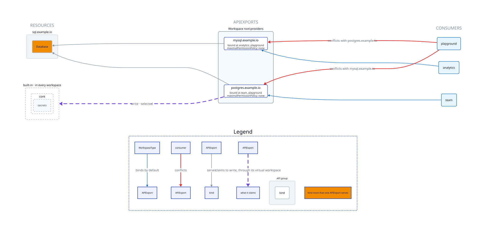

apiexport-pie
===

Visualize [kcp](https://www.kcp.io/) APIExports and relations, without torching the earth for tokens.

## Purpose

The outputs show which kinds ship together in an APIExport, and the workspaces binding them. Claimed permissions are shown on arrows (read, write, all verbs).

`--diff` compares two versions of a tree: a PR branch against main, or one release tag against the
next.

For the output types in detail and the kcp concepts behind them, see [MANUAL.md](MANUAL.md).

### APIExports

kcp [APIExports](https://docs.kcp.io/kcp/v0.33/reference/crd/apis.kcp.io/apiexports/) are effectively API definitions described through resource schemas and the permissions a provider serving the API may claim.

Since this means a lot of YAML, reading complex APIs or reviewing changes is mentally taxing, error prone, and hard to do unassisted.

## Install

```sh
go install github.com/bmarinov/apiexport-pie@latest
```

`apiexport-pie --version` prints the version installed.

### Dependencies

Drawing images requires [d2](https://d2lang.com) on PATH; the examples are drawn with d2 v0.6.9.
A git ref as a tree needs git.

### Tests

```sh
go test ./...
go test -tags integration ./...
```

The integration tests draw with d2, and verify `root` and `root:universal` assumptions baked into the tool against kcp.

## Usage

```
apiexport-pie [-v] [--style classic|overview] [-o FILE [--watch]] TREE
apiexport-pie [-v] --surface [-o FILE [--watch]] TREE
apiexport-pie [-v] --diff [--surface|--style overview [-o FILE]] A B
apiexport-pie --version
```

TREE, A and B are each a directory of manifests or `[REMOTE#]REF:PATH`: PATH at commit REF of this
repository, or of REMOTE (a remote name, URL or path). `--watch` needs a directory.

## Flags

| Flag | Effect |
|---|---|
| `--style STYLE` | Diagram style: `classic` (default) or `overview`. Not with `--surface`; with `--diff`, `overview` only. |
| `--surface` | The surface table instead of the diagram. |
| `--diff` | What changes from tree A to tree B. With `--surface`, both tables as one; with `--style overview`, both trees as one overview. |
| `-o FILE` | Write to FILE instead of stdout; the extension picks the format (below). With `--diff`, only with `--surface` or `--style overview`. |
| `--watch` | With `-o FILE.d2`: rewrite FILE when a manifest changes and show it with `d2 --watch`. Not with `--diff`. |
| `-v` | Also list the documents that are not drawn. |
| `-h` | Usage and flags. |
| `--version` | The version installed. |

| `-o` FILE ends in | Output |
|---|---|
| `.svg`, `.png`, `.pdf` | drawn by d2 (PNG and PDF force a browser download on first use) |
| `.d2` | d2 source |
| other file extension | d2 source; markdown with `--surface` |

## Outputs

- **classic** (default): a table per consumer (workspaces or a
  directory of APIBinding files) and per APIExport, with arrows from bindings to exports and from claims to the claimed kinds.
- **overview**: three columns: CONSUMERS -> APIEXPORTS -> RESOURCES.
- **surface**: a row per kind and per set of claims, columns generated per consumer.
- **diff**: a line per change from A to B.
  - `added:`, `removed:`, `moved:`, `changed:`: exports, kinds, claims, consumers and APIBindings; as a new workspace gets them.
  - `existing:`: what workspaces that already exist keep when a kind moves to another export. The old binding keeps serving it; a binding of the new export gets `NamingConflicts`.

Warnings and notices are printed to stderr. Any kind in more than one APIExport is flagged with orange.

### Example

[examples/shared-api-conflict/apis.yaml](examples/shared-api-conflict/apis.yaml) holds two
APIExports serving the same `Database` kind. One WorkspaceType binds two of them which kcp will refuse.

```sh
apiexport-pie --style overview -o overview.svg examples/shared-api-conflict
```



On stderr:

```
warning: apis.yaml#6: WorkspaceType playground binds postgres.example.io and mysql.example.io, which both serve databases.sql.example.io; kcp binds only one of them
notice: apis.yaml#2: API group sql.example.io is served by 2 APIExports: postgres.example.io, mysql.example.io
```

## Disclaimer on LLM use

The code was written by an LLM. The design follows what I wanted the diagrams to show. Displayed information and assumptions related to bindings, workspaces and claims were verified against the kcp source.
